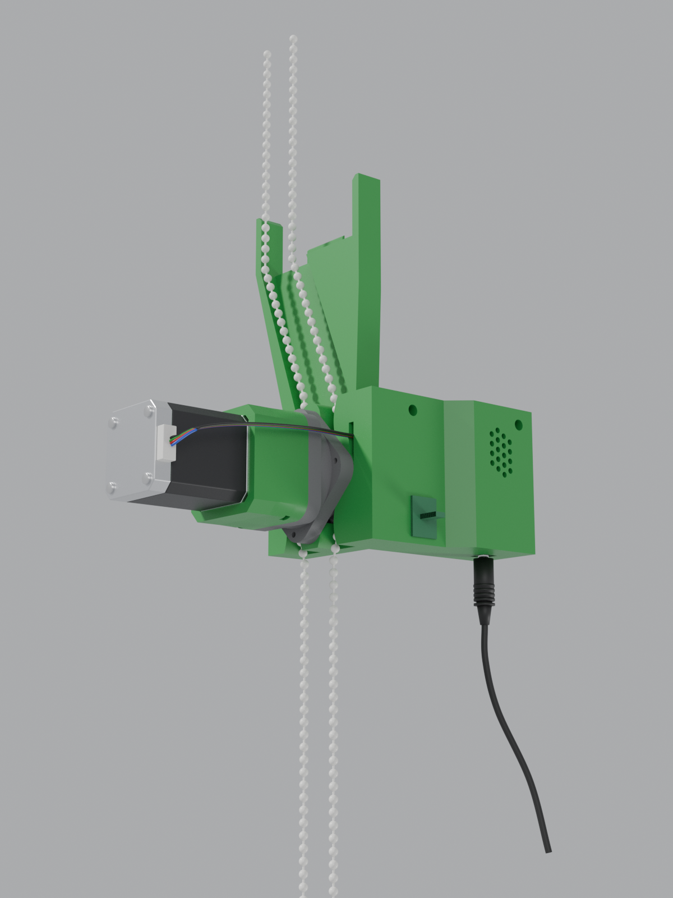
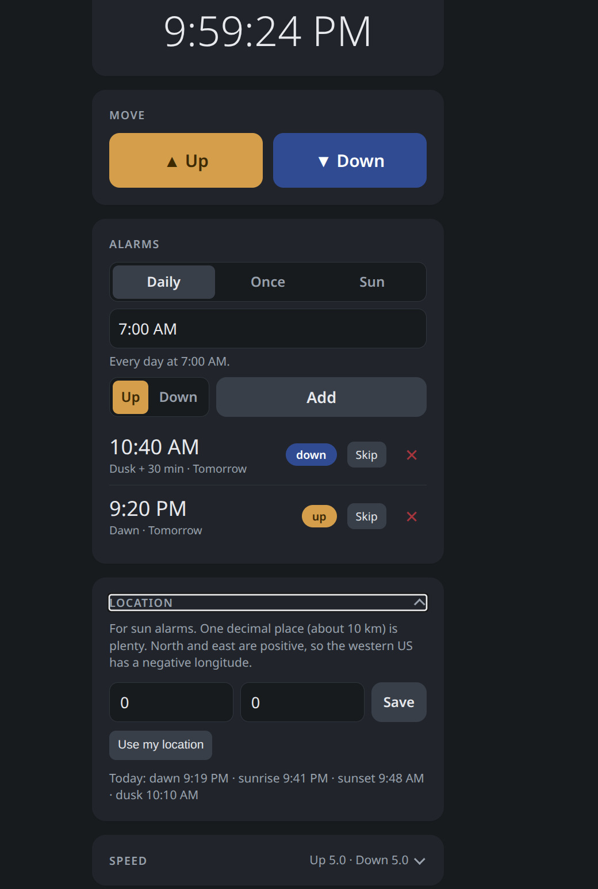

# Blinds controller

Electronic device to open and close blinds (using a standard 4.5mm bead chain)
automatically.

  
  &emsp;&emsp;
  

I have not tested this extensively, consider this as notes after creating one
working model.

This repository includes 3d designs for an enclosure, pcb design, firmware,
and an android app. The enclosure (but not the .blend assembly) was designed without AI.

The blinds can go up and down using the switch, an ir remote, wifi interface, or alarms. The alarms can be set based on the sunrise and sunset.

Assembly
=====

PCB
---
   * This uses a separate ESP32 dev kit as well as a TMC2226 stepstick module that are soldered onto the board, on their own pins.
   * Design files and BOM are in the repository. A slightly different ESP32 and stepstick module may work, but may require firmware updates.
   * This is hand-solderable, and there is a hand soldering guide in this repository's [github pages](https://yahya-tamur.github.io/blinds/soldering-guide-v0.2.0/).

Additional items required
------
 * Nema 17 stepper motor
    * A motor of any length is fine, though my blinds are pretty heavy, and work best with a 60mm motor.
    * Different motors may require a current adjustment in the firmware
    * The cable needs to be JST-XH 4-pin, with one coil on pins 1-2, the other on pins 3-4.
 * 3 mm bolts of various sizes and hex nuts
 * 3 x 10 mm metal dowel pins
 * one bearing same size as 693zz
 * Power adapter: 24V 2 amp 5.5 × 2.5 mm barrel plug, center positive. 
 * six 5 x 2 mm magnets, attached in alternating polarity to the sprocket with super glue.
    * These are used alongside Hall sensors to detect sprocket position.
 * A 5mm [flange coupler](https://www.amazon.com/dp/B08334MFVT) This is put on the motor shaft, flat face towards the outside.
   Four small bolts are bolted on to the holes, bolt heads facing out. These interface with the sun gear of 'planetary'. If you
   use a different flange coupler, you may have to edit that interface of the sun gear.
* CR2032 coin cell to keep the timing chip on if power is lost (optional). A rechargeable LIR2032 won't be charged.
* any NEC ir remote (optional)

3d printing the enclosure
-------

* I don't know if this physically fits any other blinds, you may need to edit 'enclosure'.
* The 'planetary' (make sure to separate stl by parts before slicing), 'carrier2', and 'sprocket' are designed to be printed
  in PA6-GF25 or similar 'engineering filament'.
  * Use grease on these parts.
  * The planetary gears should be printed in place, but will easily go out of alignment without 'carrier2' and 'sprocket' installed. There are dots to help with alignment.
* Any other part can be printed with PLA pro.
* Auto orient the parts, and hand paint supports in a few obvious spots.
* For final assembly, take a look at `enclosure/assembly.blend`. It doesn't include the 3x10 dowel pins in a few obvious places.

firmware
------
  * Copy `wifi.example.properties` into `wifi.properties` and aet the wifi SSID and password.
  * Build and flash in the `firmware/` folder using ESP-IDF v6.1. For the first flash, you need to connect to the devkit via USB, which isn't accessible when it's in the enclosure. Future firmware updates can be done over wifi.
  * In the WiFi interface (find the device's ip address on your router. `blinds.lan` may work for some routers):
    * Set up the beginning and the end of the movement.
    * For calculating sunrise and sunset, enter an approximate location.
      * To get the browser's location to setup sunrise / sunset alarms, it can access this repository's github pages to request permission. This is because only https
      sites can do so. The actual location isn't sent, it's just used in the browser
      to set in the device.
    * You can also set up an IR remote here.

  * Afterwards, alarms may be set on the wifi site or on the app. The switch, the remote, the website, or the app can make the blinds go up or down.

android app
----
  * apk available in releases
  * The android app makes sure it's connected to the same wifi, then accesses the wifi interface.
  * It can also set alarms in the blinds and the android clock app at the same time.
