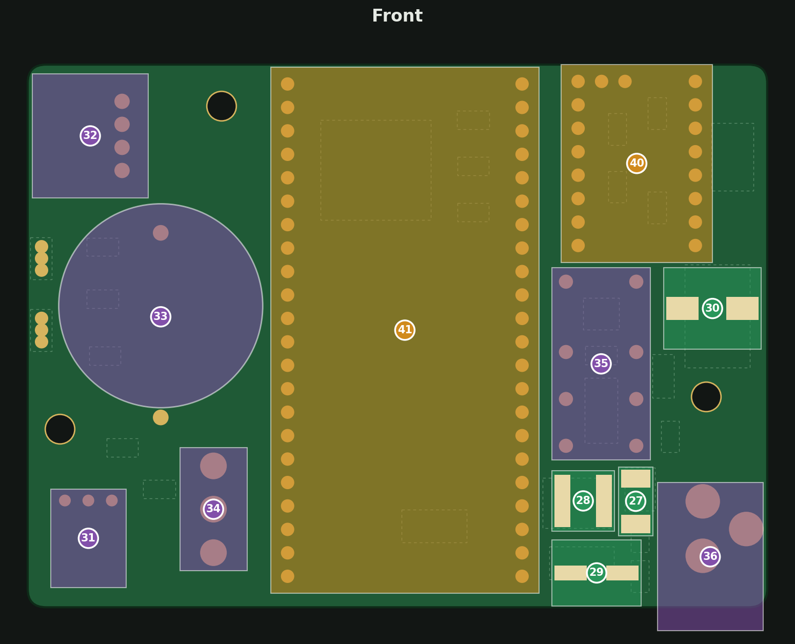
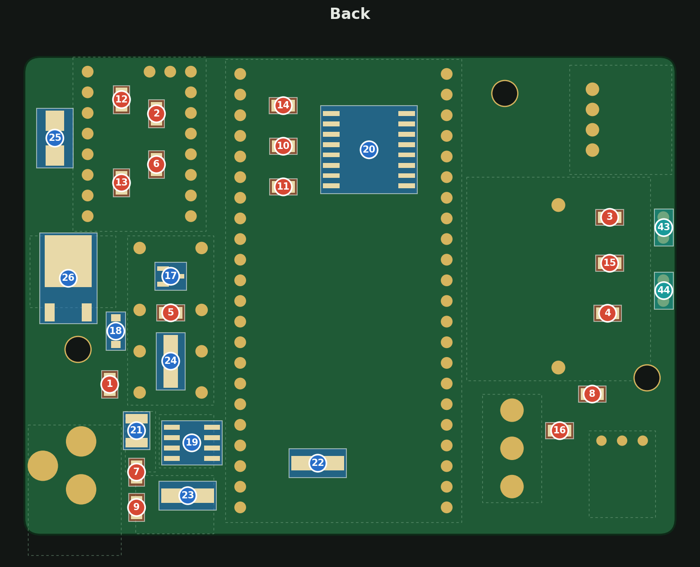

# Carrier v0.2.0 — Soldering Guide

v0.2.0 board (80.1 × 58.8 mm), 2026-11-01. Interactive version: this folder's `index.html` (on the site: `soldering-guide-v0.2.0/`).

Solder the 40 parts in number order, with two multimeter checks of the power supply on the way and a relay check at the end. The back goes first, while both sides are still flat: the small 0805 parts (red), then the chips and diodes (blue). Then the front: the low SMD parts (green), the through-hole parts (purple), the two modules (amber), and the Hall sensors last, back on the back (teal). The back picture is drawn as you see it when soldering the back, so it is mirrored left-right; directions for back parts refer to that picture.

## Parts in soldering order

### Back: resistors and capacitors (0805)

| # | Part | LCSC | Orientation |
| --- | --- | --- | --- |
| 1 | 47k resistor (R1) | C17713 | None |
| 2 | 10k resistor (R2) | C17414 | None |
| 3 | 10k resistor (R11) | C17414 | None |
| 4 | 10k resistor (R13) | C17414 | None |
| 5 | 10k resistor (R16) | C17414 | None |
| 6 | 1k resistor (R3) | C17513 | None |
| 7 | 1k resistor (R14) | C17513 | None |
| 8 | 100 Ω resistor (R4) | C17408 | None |
| 9 | 3.3k resistor (R15) | C26010 | None |
| 10 | 4.7k resistor (R17) | C17673 | None |
| 11 | 4.7k resistor (R18) | C17673 | None |
| 12 | 100 nF capacitor (C5) | C49678 | None |
| 13 | 100 nF capacitor (C6) | C49678 | None |
| 14 | 100 nF capacitor (C7) | C49678 | None |
| 15 | 100 nF capacitor (C13) | C49678 | None |
| 16 | 4.7 µF capacitor (C8) | C1779 | None |

### Back: chips, diodes and transistors

| # | Part | LCSC | Orientation |
| --- | --- | --- | --- |
| 17 | 2N7002 transistor (SOT-23) (Q2) | C8545 | Single leg on the right |
| 18 | 15 V zener (SOD-123) (D2) | C2126 | Band (−) down |
| 19 | XL1509 buck regulator (SOIC-8) (U2) | C74192 | Pin 1 dot top-left |
| 20 | DS3231 clock (SOIC-16) (U5) | C9866 | Pin 1 dot top-left |
| 21 | 10 µF 50 V capacitor (1210) (C14) | C138687 | None |
| 22 | SS14 diode (5 V path) (D4) | C2480 | Band (−) to the left |
| 23 | SS16 diode (buck) (D5) | C2481 | Band (−) to the left |
| 24 | SS14 diode (relay coil) (D6) | C2480 | Band (−) down |
| 25 | 24 V TVS (SMB) (D1) | C83268 | Either way round (bidirectional) |
| 26 | P-channel MOSFET (DPAK) (Q1) | C513222 | Big tab up, two legs down |

### Front: fuse, inductor, electrolytic capacitors

| # | Part | LCSC | Orientation |
| --- | --- | --- | --- |
| 27 | 3 A fuse (F1) | C178991 | None |
| 28 | 68 µH inductor (L1) | C168091 | None |
| 29 | 220 µF 10 V capacitor (C16) | C7469982 | + pad on the left, black stripe (−) right |
| 30 | 100 µF 50 V capacitor (C4) | C178548 | + pad on the left, black stripe (−) right |

### Front: through-hole parts

| # | Part | LCSC | Orientation |
| --- | --- | --- | --- |
| 31 | IR receiver (U6) | C141632 | Stand it with the lens toward the top of the board, then down into the square. OUT leg on the right |
| 32 | Motor connector (right angle) (J2) | C157925 | Opening toward the left edge |
| 33 | CR2032 holder (BT1) | C5239862 | + clip at the bottom |
| 34 | Toggle switch (S1) | C55072606 | Either way round; the lever flips up and down |
| 35 | Relay (K1) | C18198081 | Pin 1 / coil end (marked) at the top |
| 36 | Power jack (J1) | C381115 | None |

### Power check (24 V in)

Check the power supply before the modules go on, while a wrong voltage can't damage them yet. Plug the 24 V supply's cord into J1. Set the multimeter to DC volts, keep the black probe on ground (C4's striped − pad) and touch the red probe to each point:

| # | Check | Expect |
| --- | --- | --- |
| 37 | C4's + pad | ≈ 24 V |
| 38 | C16's + pad | 5.1–5.5 V |
| 39 | D4's band end (back) | 4.8–5.5 V |

Unplug the cord before you solder the modules. If a reading was off:

- C4 at 0 V: no power gets past Q1. Check F1, Q1, R1 and D2.
- C16 off: the 5 V regulator. Check U2, R14 (1k), R15 (3.3k), L1 and D5.
- D4 well below C16: check D4's direction (band to the left on the back).

### Front: modules

| # | Part | LCSC | Orientation |
| --- | --- | --- | --- |
| 40 | TMC2209 StepStick, then its 9 × 9 × 5 mm heatsink (U4) | on hand | EN pin top-left (INDEX/DIAG pins along the top). Solder on its own pins; keep the heatsink inside the pin rows |
| 41 | ESP32-S3 DevKit (U3) | on hand | Antenna at the top, hanging past the edge; USB at the bottom. Solder on its own pins |

### 3.3 V check (24 V in)

Plug the cord into J1 again. Black probe on ground, red probe on:

| # | Check | Expect |
| --- | --- | --- |
| 42 | DevKit's 3V3 pin (top left) | 3.2–3.4 V |

Unplug the cord before you go on. If the reading is low, or the DevKit gets warm, unplug at once: look for a short on the 3.3 V parts (U5, U6, C6, C7) or a solder bridge on the DevKit's pins.

### Back: Hall sensors

| # | Part | LCSC | Orientation |
| --- | --- | --- | --- |
| 43 | Hall sensor A (top) (U7) | C111925 | Insert into enclosure, then put board on top to get the right pin length. Chamfered side facing left. |
| 44 | Hall sensor B (bottom) (U8) | C111925 | Same as U7 |

### Relay check (nothing plugged in)

Last, check that the motor relay keeps the motor disconnected when the board is off. Plug the motor into J2, with the 24 V cord and USB unplugged.

| # | Check | Expect |
| --- | --- | --- |
| 45 | Spin the motor shaft quickly by hand | DevKit LEDs stay off |

If a DevKit LED lights, the spinning motor is powering the board through the driver, so K1 isn't opening: check that K1 is the right way round (pin 1 at the top) and for solder bridges between its pins.

### Coin cell

Put a CR2032 in BT1, + side up, before running the firmware's bring-up test. The cell keeps the clock running while the board is off: the test sets the clock on its first run, and on the next run (after a minute or more with the board unplugged) checks that it kept time.

Also: trim the module pins and the through-hole leads on the back to about 2 mm, so the back stays flat against its standoffs.
