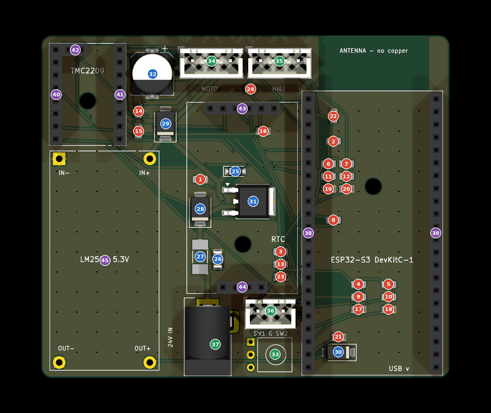

# Carrier Rev 2 — Soldering Guide

Rev 2 board, 2026-10-28. Interactive version: https://yahya-tamur.github.io/blinds/soldering-guide/ (this folder's `index.html`).

Solder the 45 parts in number order: lowest and smallest first, so the board lies flat while you work. Colours mark the stages: red = 0805 resistors and capacitors, blue = diodes, fuse, MOSFET and C4, green = through-hole parts and connectors, purple = sockets and the LM2596.

## Parts in soldering order

| # | Part | LCSC | Orientation |
| --- | --- | --- | --- |
| 1 | 47k resistor (R1) | C17713 | None |
| 2 | 10k resistor (R2) | C17414 | None |
| 3 | 10k resistor (R5) | C17414 | None |
| 4 | 10k resistor (R7) | C17414 | None |
| 5 | 10k resistor (R9) | C17414 | None |
| 6 | 10k resistor (R11) | C17414 | None |
| 7 | 10k resistor (R13) | C17414 | None |
| 8 | 1k resistor (R3) | C17513 | None |
| 9 | 1k resistor (R6) | C17513 | None |
| 10 | 1k resistor (R8) | C17513 | None |
| 11 | 1k resistor (R10) | C17513 | None |
| 12 | 1k resistor (R12) | C17513 | None |
| 13 | 100 Ω resistor (R4) | C17408 | None |
| 14 | 100 nF capacitor (C5) | C49678 | None |
| 15 | 100 nF capacitor (C6) | C49678 | None |
| 16 | 100 nF capacitor (C7) | C49678 | None |
| 17 | 100 nF capacitor (C9) | C49678 | None |
| 18 | 100 nF capacitor (C10) | C49678 | None |
| 19 | 100 nF capacitor (C11) | C49678 | None |
| 20 | 100 nF capacitor (C12) | C49678 | None |
| 21 | 10 µF capacitor (C2) | C15850 | None |
| 22 | 10 µF capacitor (C3) | C15850 | None |
| 23 | 4.7 µF capacitor (C8) | C1779 | None |
| 24 | 4.7 µF capacitor (C13) | C1779 | None |
| 25 | 15 V zener diode (D2) | C2126 | Band to the left |
| 26 | 1 µF 100 V capacitor, 1206 (C1) | C13832 | None |
| 27 | 3 A fuse (F1) | C178991 | None |
| 28 | 33 V TVS diode (D1) | C2938921 | None (bidirectional) |
| 29 | 24 V TVS diode (D3) | C224017 | Band down |
| 30 | Schottky diode SS14 (D4) | C2480 | Band to the right |
| 31 | P-channel MOSFET (Q1) | C513222 | Big tab on the big pad (right); two legs on the left |
| 32 | 100 µF 50 V electrolytic capacitor (C4) | C178548 | + pad at the top; black stripe (minus) down |
| 33 | IR receiver (U6) | C141632 | Stand it with the lens facing left (towards the jack), then bend the legs so the body lies flat to the right, lens up. OUT leg in the square hole (top) |
| 34 | 4-pin JST connector, motor (J2) | C144395 | Pin 1 (square pad) on the left; locking ramp as on the silkscreen |
| 35 | 4-pin JST connector, Hall sensors (J4) | C144395 | Pin 1 (square pad) on the left; locking ramp as on the silkscreen |
| 36 | 3-pin JST connector, switches (J3) | C144394 | Pin 1 (square pad, SW1) on the left; locking ramp as on the silkscreen |
| 37 | 24 V power jack (J1) | C381115 | Opening at the bottom edge (fits one way only) |
| 38 | DevKit left socket row: 1x20 + 1x02 | C2897383 + C2897365 | 1x20 at the top, 1x02 below it; file the touching ends flat; solder with the DevKit plugged in |
| 39 | DevKit right socket row: 1x20 + 1x02 | C2897383 + C2897365 | Same as 38 |
| 40 | StepStick left socket, 1x8 | C2897371 | Solder with the StepStick plugged in |
| 41 | StepStick right socket, 1x8 | C2897371 | Same |
| 42 | StepStick top pair (INDEX, DIAG), 1x2 | C2897365 | Same |
| 43 | DS3231 signal socket, 1x6 | C2897369 | Solder with the DS3231 plugged in |
| 44 | DS3231 support socket, 1x4 | C2897367 | Same |
| 45 | LM2596 module on 4 pins from the 40-pin strip | C2337 | IN+ / IN− at the top; IN− is the square pad, top-left |
